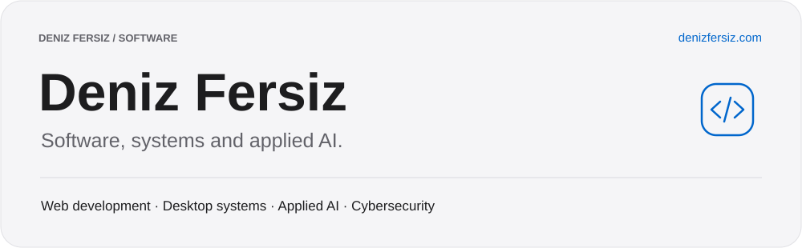
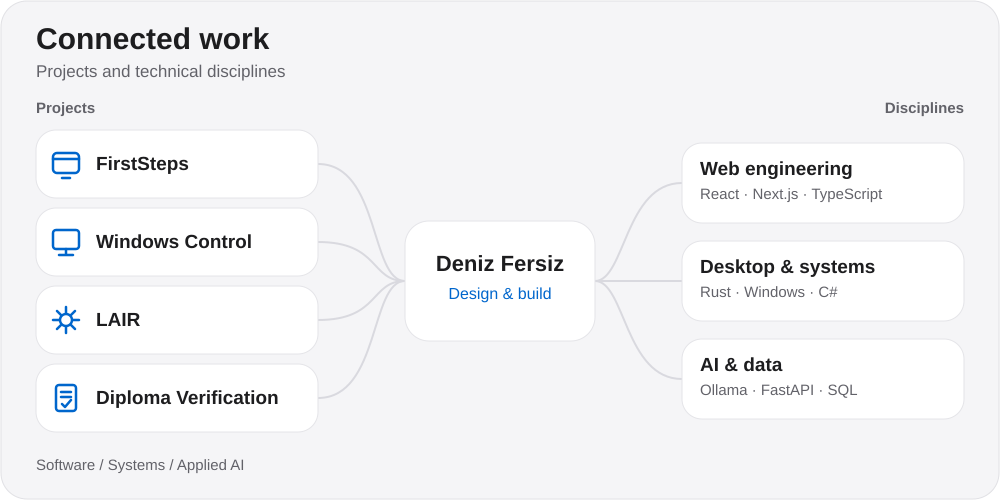
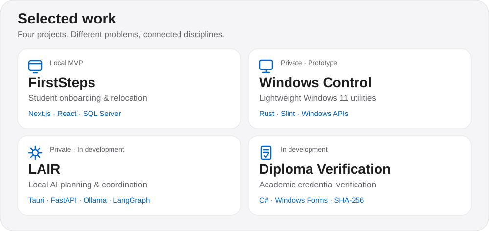
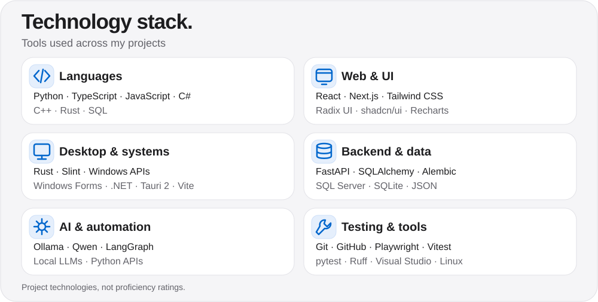
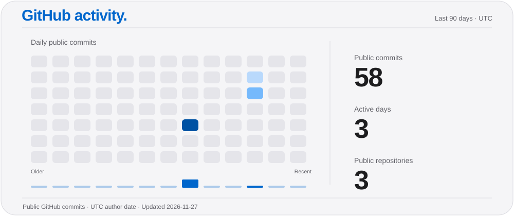
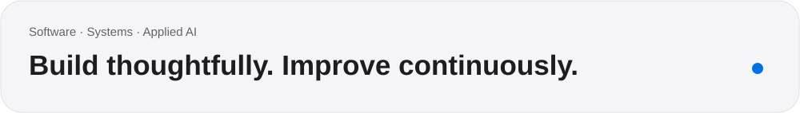

 

   

## 01 / ABOUT

I focus on **software development, system architecture, cybersecurity, and applied AI**. When building web and desktop applications, I care about more than a working interface: I want to understand the underlying system, its design choices, and what can go wrong.

My work brings together user experience, data management, local AI models, and automation. I aim to develop useful and maintainable software that solves real problems.

`Full-stack Development` · `Desktop Systems` · `Cybersecurity` · `Networking` · `Applied AI`

## 02 / SYSTEM MAP

My work connects web development, desktop systems, and AI-supported workflows. This diagram shows how my projects relate to the technical areas I explore.

## 03 / FEATURED PROJECTS

### [01 / FirstSteps](https://github.com/deniziuss/firststeps)

An onboarding and relocation platform for international students. It includes personalized task plans, dependency management, source review, progress tracking, and mentor support. **Working local MVP; not deployed.**

`Next.js 16` · `React 19` · `TypeScript` · `SQL Server` · `Tailwind CSS` · `Radix UI` · `Recharts`

### 02 / Windows Control

A lightweight Windows 11 utility suite written in Rust. It includes a read-only system monitoring dashboard, an application launcher, a colour picker and opt-in clipboard history. **Private prototype; not publicly distributed.**

`Rust` · `Slint` · `Windows APIs` · `Windows 11`

### 03 / LAIR — Local Autonomous Intelligence Router

A desktop project for task planning and AI workflow coordination with local models. It combines Qwen/Ollama inference, a Python/FastAPI backend, a React/Tauri interface, and approval-based manual handoffs. **In development:** specialist execution remains simulated and automatic paid-provider access is disabled.

`Python` · `FastAPI` · `TypeScript` · `React` · `Tauri 2` · `Rust` · `SQLite` · `Ollama` · `LangGraph`

LAIR is developed in a private repository; its source code is not public.

### [04 / Diploma & Certificate Verification System](https://github.com/deniziuss/DiplomaCertificateVerificationSystem)

A C# desktop application for issuing and verifying academic credentials. It includes unique credential identifiers, SHA-256 integrity validation, and JSON persistence. Remaining modules and integration are still in progress.

`C#` · `.NET 10` · `Windows Forms` · `SHA-256` · `JSON`

## 04 / TECHNOLOGY STACK

This section includes not only the languages GitHub automatically detects, but also **frameworks, libraries, and tools used across FirstSteps, Windows Control, LAIR, and my other work**. The matrix is not a proficiency score or arbitrary percentage chart.

**Languages**

      

**Web & UI**

      

**Desktop Development**

      

**Backend & Data**

     

**AI & Automation**

    

**Testing & Developer Tools**

       

## 05 / GITHUB ACTIVITY

This chart shows commits attributed to my GitHub account in my public repositories over the last 90 days (UTC). It excludes private repositories, pull requests, issues, and other contribution types. GitHub Actions refreshes it daily. [My GitHub profile](https://github.com/deniziuss).

## 06 / CONNECT

Explore my projects or get in touch:

   

