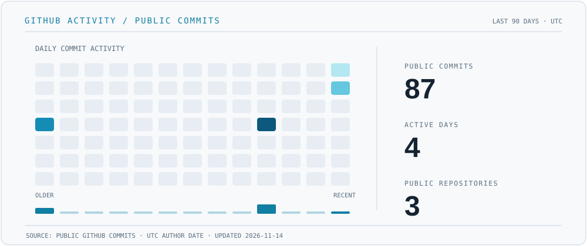

 

   

## 01 / HAKKIMDA

**Yazılım geliştirme, sistem mimarisi, siber güvenlik ve uygulamalı yapay zekâ** alanlarına odaklanıyorum. Web ve masaüstü uygulamaları geliştirirken yalnızca çalışan bir sonuç üretmekle değil, sistemin arka planını, teknik kararları ve karşılaşılabilecek sorunları anlamakla ilgileniyorum.

Projelerimde kullanıcı deneyimi, veri yönetimi, yerel yapay zekâ modelleri ve otomasyon gibi alanları bir araya getiriyorum. Hedefim, gerçek problemlere çözüm sunan, sürdürülebilir ve geliştirilebilir yazılımlar oluşturmak.

`Full-stack Development` · `Desktop Systems` · `Cybersecurity` · `Networking` · `Applied AI`

## 02 / SİSTEM HARİTASI

Çalışmalarım web geliştirme, masaüstü sistemleri ve AI destekli iş akışları etrafında birleşiyor. Bu şema, projelerim ve ilgilendiğim teknik alanlar arasındaki bağlantıyı gösteriyor.

## 03 / ÖNE ÇIKAN PROJELER

### [01 / FirstSteps](https://github.com/deniziuss/firststeps)

Uluslararası öğrencilerin yeni bir ülkeye yerleşme sürecini kolaylaştırmak için geliştirdiğim platform. Kişiye özel görev planları, görev bağımlılıkları, kaynak inceleme, ilerleme takibi ve mentor destek sistemi içeriyor. **Yerel ortamda çalışan MVP; henüz yayına alınmadı.**

`Next.js 16` · `React 19` · `TypeScript` · `SQL Server` · `Tailwind CSS` · `Radix UI` · `Recharts`

### 02 / LAIR — Local AI Router

Yerel modeller üzerinden görev planlama ve yapay zekâ iş akışı koordinasyonu için geliştirdiğim masaüstü proje. Qwen/Ollama çıkarımı, Python/FastAPI arka ucu, React/Tauri arayüzü ve onaya dayalı manuel görev devri üzerinde çalışıyor. **Geliştirme aşamasında:** uzman yürütme simülasyonla sınırlı; ücretli sağlayıcıların otomatik kullanımı kapalı.

`Python` · `FastAPI` · `TypeScript` · `React` · `Tauri 2` · `Rust` · `SQLite` · `Ollama` · `LangGraph`

LAIR özel bir depoda geliştiriliyor; kaynak kodu herkese açık değil.

### [03 / Diploma & Certificate Verification System](https://github.com/deniziuss/DiplomaCertificateVerificationSystem)

Akademik belgelerin oluşturulması ve doğrulanması için geliştirilen C# masaüstü uygulaması. Benzersiz belge kimlikleri, SHA-256 bütünlük kontrolü ve JSON tabanlı kayıt içeriyor. Diğer modüller ve tam entegrasyon üzerinde çalışma sürüyor.

`C#` · `.NET 10` · `Windows Forms` · `SHA-256` · `JSON`

## 04 / TEKNOLOJİLER

Sadece GitHub'ın otomatik algıladığı dilleri değil, **FirstSteps, LAIR ve diğer çalışmalarımda kullandığım framework, kütüphane ve araçları** da burada topladım. Bu liste bir yetkinlik puanı veya yüzde grafiği değildir.

**Programlama Dilleri**

      

**Web ve Arayüz**

      

**Masaüstü Geliştirme**

    

**Backend ve Veritabanı**

     

**Yapay Zekâ ve Otomasyon**

    

**Test ve Geliştirme Araçları**

       

## 05 / GITHUB AKTİVİTESİ

Bu grafik, son 90 gün içinde kendi herkese açık depolarımda GitHub hesabıma atfedilen commitleri gösterir (UTC). Özel depolar, pull request ve issue gibi diğer katkılar dahil değildir. GitHub Actions ile günlük güncellenir. [GitHub profilim](https://github.com/deniziuss).

## 06 / İLETİŞİM

Projelerimi incelemek veya iletişim kurmak için:

   

