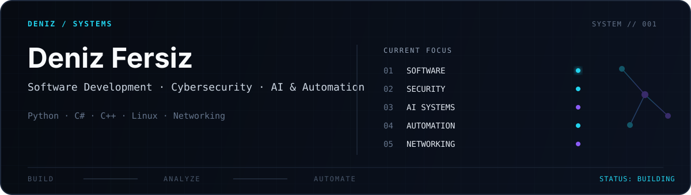

<picture>
  <source media="(prefers-color-scheme: dark)" srcset="./assets/header-dark.svg">
  <source media="(prefers-color-scheme: light)" srcset="./assets/header-light.svg">
  
</picture>

  
  
  

  <b>English</b> &nbsp;·&nbsp; <a href="./README.tr.md">Türkçe</a>

## 01 / ABOUT

I develop software with an interest in how systems work beyond the interface. My work spans **web and desktop development**, while I continue exploring **cybersecurity, networking, and applied AI**.

I enjoy understanding the technical decisions behind a solution, working through difficult problems, and turning ideas into practical, reliable projects.

---

## 02 / FOCUS

- **Software Development** — Web applications, desktop tools, backend logic, and databases.
- **Cybersecurity & Networking** — Linux, network fundamentals, system behavior, and security concepts.
- **AI & Automation** — Local models, intelligent workflows, and practical integrations.

---

## 03 / SELECTED PROJECTS

### [FirstSteps](https://github.com/deniziuss/firststeps)

A personalized relocation and onboarding platform for international students, featuring structured task plans, verified-source workflows, progress tracking, and mentor support.

`Next.js` · `React` · `TypeScript` · `Microsoft SQL Server` — **Local MVP**

### [Diploma & Certificate Verification System](https://github.com/deniziuss/DiplomaCertificateVerificationSystem)

A Windows desktop application for issuing and verifying academic credentials, with SHA-256 integrity checks and JSON-based persistence.

`C#` · `.NET 10` · `Windows Forms` — **In development**

---

## 04 / TECHNOLOGIES

  <picture>
    <source media="(prefers-color-scheme: dark)" srcset="https://skillicons.dev/icons?i=py,cpp,cs,dotnet,ts,react,nextjs,tailwind,git,linux,vscode,visualstudio&amp;theme=dark&amp;perline=6">
    <source media="(prefers-color-scheme: light)" srcset="https://skillicons.dev/icons?i=py,cpp,cs,dotnet,ts,react,nextjs,tailwind,git,linux,vscode,visualstudio&amp;theme=light&amp;perline=6">
    
  </picture>

Also working with Microsoft SQL Server · Windows Forms · Vitest · Playwright

---

## 05 / GITHUB ACTIVITY

  <picture>
    <source media="(prefers-color-scheme: dark)" srcset="https://github-profile-summary-cards.vercel.app/api/cards/profile-details?username=deniziuss&amp;theme=github_dark">
    <source media="(prefers-color-scheme: light)" srcset="https://github-profile-summary-cards.vercel.app/api/cards/profile-details?username=deniziuss&amp;theme=github">
    
  </picture>

  <picture>
    <source media="(prefers-color-scheme: dark)" srcset="https://github-profile-summary-cards.vercel.app/api/cards/stats?username=deniziuss&amp;theme=github_dark">
    <source media="(prefers-color-scheme: light)" srcset="https://github-profile-summary-cards.vercel.app/api/cards/stats?username=deniziuss&amp;theme=github">
    
  </picture>
  <picture>
    <source media="(prefers-color-scheme: dark)" srcset="https://github-profile-summary-cards.vercel.app/api/cards/repos-per-language?username=deniziuss&amp;theme=github_dark">
    <source media="(prefers-color-scheme: light)" srcset="https://github-profile-summary-cards.vercel.app/api/cards/repos-per-language?username=deniziuss&amp;theme=github">
    
  </picture>

