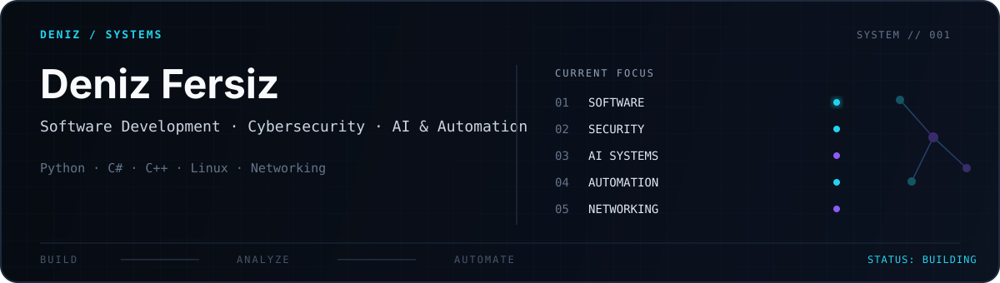

  <a href="./README.md">English</a>
  &nbsp;•&nbsp;
  <b>Türkçe</b>

<picture>
  <source
    media="(prefers-color-scheme: dark)"
    srcset="./assets/header-dark.svg"
  >
  <source
    media="(prefers-color-scheme: light)"
    srcset="./assets/header-light.svg"
  >
  
</picture>

## 01 / HAKKIMDA

 **yazılım geliştirme, siber güvenlik, ağ teknolojileri ve yapay zekâ** ile ilgileniyorum.

Bir şey geliştirirken sadece kodun çalışması pek yeterli gelmiyor. Arkada ne olduğunu, sistemin neden o şekilde davrandığını ve bir problem çıktığında sorunun nereden kaynaklandığını da anlamaya çalışıyorum. Zaten ilgimi sistem ve network tarafına çeken şeylerden biri de bu.

Şu anda en çok **Python, C# ve C++** ile çalışıyorum. Bunun yanında Linux, ağ teknolojileri, otomasyon ve yapay zekânın normal yazılım projelerinde gerçekten işe yarayabileceği alanlarla uğraşıyorum.

Hâlâ öğrenme ve deneme aşamasındayım. Aklıma gelen her şeyi proje diye koymak yerine, işe yaradığına inandığım fikirleri zamanla düzgün projelere çevirmeye çalışıyorum.

**İlgilendiğim alanlar —** Yazılım Geliştirme · Siber Güvenlik · Ağ Teknolojileri · Yapay Zekâ & Otomasyon

---

## 02 / ODAK

### Yazılım Geliştirme

Yaptığım işlerin çoğu burada başlıyor. Masaüstü uygulamaları, küçük araçlar ve belirli bir problemi çözmek için geliştirdiğim yazılımlar üzerinde çalışıyorum.

Sırf GitHub'da bir proje daha bulunsun diye bir şey yapmak yerine, gerçekten kullanabileceğim veya bana bir şey öğretecek projeler geliştirmeyi daha mantıklı buluyorum.

`Python` · `C#` · `C++` · `.NET` · `WPF`

### Siber Güvenlik & Ağ Teknolojileri

Sistemlerin birbiriyle nasıl iletişim kurduğu, ağ üzerinde bir problemin neden ortaya çıktığı ve bunun yazılım tarafında ne kadarının görülebildiği ilgimi çekiyor.

Hazır araçları kullanmanın yanında, mümkün olduğunca o aracın arka tarafta ne yaptığını da anlamaya çalışıyorum.

`Linux` · `TCP/IP` · `DNS` · `Ağ Analizi`

### Yapay Zekâ & Otomasyon

Yapay zekâyı tek başına ayrı bir alan olarak görmekten çok, normal bir yazılımın içine gerçekten fayda sağlayacak şekilde nasıl eklenebileceğiyle ilgileniyorum.

LLM'ler, API'ler ve otomasyon tarafında denemeler yapıyorum. Özellikle tekrar eden işleri azaltan, bilgiyi işleyen veya mevcut bir aracı daha kullanışlı hâle getiren kullanım alanları ilgimi çekiyor.

`Python` · `LLM` · `API` · `Otomasyon`

---

## 03 / ÖNE ÇIKAN ÇALIŞMA

### Diploma and Certificate Verification System

Ben ve arkadaşım, üniversitedeki nesne yönelimli programlama ödevimiz kapsamında **C# ve Windows Forms** ile diploma ve sertifika doğrulama sistemi geliştiriyoruz. Belge oluşturma, kayıt yönetimi, **SHA-256** bütünlük kontrolü ve basitleştirilmiş **blockchain** yapısını tek uygulamada birleştirmeyi hedefliyoruz.

Sistem beş ana bölümden oluşuyor:

- **Kimlik Doğrulama ve Üniversite Yönetimi** — kullanıcı erişimi ve üniversite kayıtları
- **Öğrenci Yönetimi** — öğrenci oluşturma ve üniversitelerle ilişkilendirme
- **Diploma ve Sertifika Oluşturma** — benzersiz kimlikler, belge bilgileri ve SHA-256 hash değerleriyle kayıt oluşturma
- **Blockchain Yönetimi** — belge düzenleme ve iptal işlemlerini birbirine bağlı bloklarda saklama
- **Doğrulama ve İptal** — belge bütünlüğünü kontrol etme, blockchain kayıtlarını sorgulama ve gerekli durumlarda belge iptali

Hedeflediğimiz akış: **giriş → üniversite kaydı → öğrenci kaydı → belge oluşturma → blockchain kaydı → doğrulama ve iptal**. Bu işlemleri tek bir uygulamada bir araya getirmek istiyoruz.

| Alan | Detay |
| --- | --- |
| Geliştirenler | Ben ve bir arkadaşım |
| Dil | C# |
| Framework | .NET 10 |
| Arayüz | Windows Forms |
| Platform | Windows |
| Konular | OOP · JSON · SHA-256 · Blockchain |
| Durum | Geliştiriliyor |

Şu ana kadar diploma ve sertifika oluşturma bölümünü geliştirip test ettik. Belge modelleri, hash doğrulaması, oluşturma arayüzü ve JSON kayıt sistemi çalışıyor. Diğer modülleri ve sistemin bütünleşik hâlini geliştirmeye devam ediyoruz.

[Projenin GitHub reposunu görüntüle →](https://github.com/deniziuss/DiplomaCertificateVerificationSystem)

---

## 04 / ŞU ANDA

Şu sıralar bir arkadaşımla geliştirdiğimiz **Diploma and Certificate Verification System** projesine odaklanıyorum. Boş zamanlarımda kalan modülleri tamamlamak ve belge oluşturma, SHA-256 doğrulama ve blockchain işlemlerini tek uygulamada birleştirmek için çalışıyorum.

Bunun dışında **otomasyon, güvenlik ve yapay zekâ** alanlarında da yeni fikirler deniyorum.

---

## 05 / KULLANDIKLARIM

Şu anda çalıştığım teknolojiler ve ilgi alanlarım.

**01 / Programlama Dilleri**

  
  
  

**02 / Masaüstü Geliştirme**

  
  
  

**03 / Sistemler ve Ağ**

  
  
  
  

**04 / Geliştirme Araçları**

  
  
  
  

**05 / İlgi Alanları**

  
  
  
  

